# Art Institute of Chicago (Compose Multiplatform)

Учебный проект каталога экспонатов Чикагского института искусств в рамках Лабораторной работы №1 (Веха В1 «Каркас»).

## Архитектура проекта

Проект построен на **Kotlin Multiplatform (Compose Multiplatform 1.7)** с модульным разделением:

- **`:shared`** — основная мультиплатформенная библиотека:
  - `domain` — доменная модель (`Artwork`) и интерфейс репозитория (`ArtworkRepository`);
  - `data` — мок-данные (строго 24 экспоната) и реализация репозитория (`MockArtworkRepository`);
  - `presentation` — экраны каталога (`list`) и деталей (`detail`), MVI-архитектура (`State`, `Intent`, `ViewModel`), компоненты и темы оформления;
  - `composeResources` — официальные ресурсы локализации на русском (`values-ru`) и английском (`values`).
- **`:desktopApp`** — модуль запуска десктопного приложения (JVM/Windows);
- **`:androidApp`** — модуль Android-приложения (`MainActivity`, манифест);
- **`:webApp`** — модуль WebAssembly / JS (`wasmJs`);
- **`tools/check-strings.py`** — скрипт автоматической проверки паритета ключей локализации между языками.

## Реализованные сценарии

1. **Список экспонатов:** Отображение 24 карточек (заголовок, автор, материал, дата, цветная заглушка с первой буквой названия).
2. **Поиск в реальном времени:** Поиск через метод репозитория с защитой от Race Condition (отмена предыдущей корутины). Кнопка очистки сбрасывает поле ввода и результаты.
3. **Сохранение состояния:** При переходе на экран деталей и возврате обратно позиция скролла и поисковый запрос полностью сохраняются.
4. **Связанные работы:** В деталях отображается блок «Другие работы этого автора» (без использования `shrinkWrap`). Переход по связанным картинам формирует стек; нажатие «Назад» возвращает строго по одному экрану.
5. **Темы оформления:** Поддержка светлой и тёмной тем Material 3 с высокой контрастностью.
6. **Локализация:** Поддержка русского и английского языков в рантайме. В коде нет захардкоженных строк.

## Запуск проекта

### Desktop (Windows / macOS / Linux)
```bash
./gradlew :desktopApp:run
```

### Web (Браузер / Wasm)
```bash
./gradlew :webApp:wasmJsBrowserDevelopmentRun
```

### Android
Запуск конфигурации `androidApp` в Android Studio на эмуляторе или подключенном устройстве.

### Проверка паритета строк
```bash
python tools/check-strings.py
```

## Скриншоты

### Android
| Тёмная тема | Светлая тема | Поиск и фильтрация |
|:---:|:---:|:---:|
| 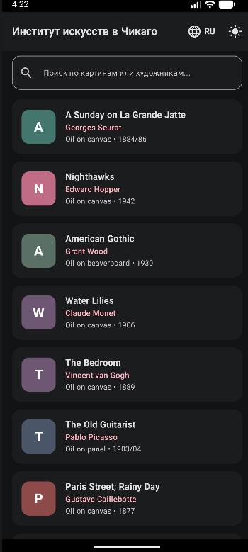 | 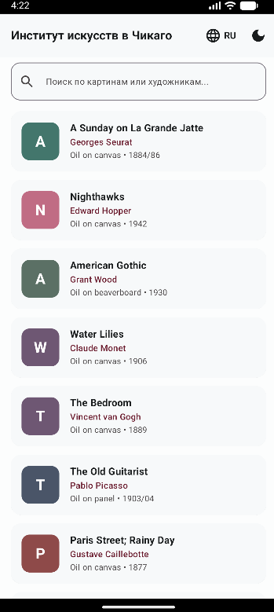 | 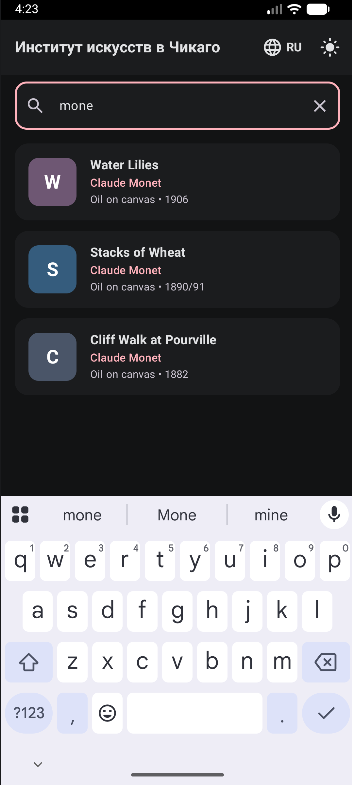 |

| Экран деталей | Связанные работы | Ничего не найдено |
|:---:|:---:|:---:|
| 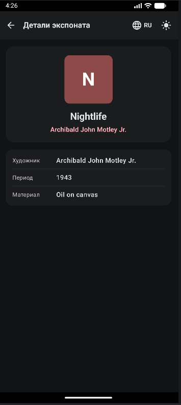 | 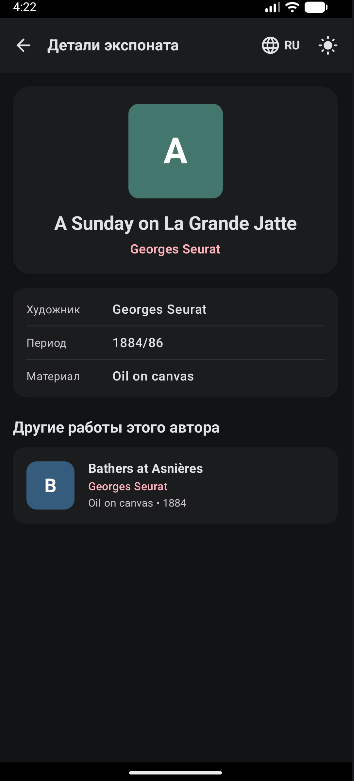 | 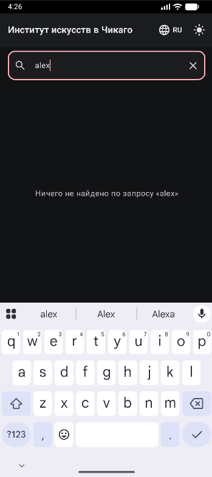 |

### Web (WebAssembly)
| Каталог (RU, тёмная) | Каталог (EN, тёмная) | Каталог (EN, светлая) |
|:---:|:---:|:---:|
| 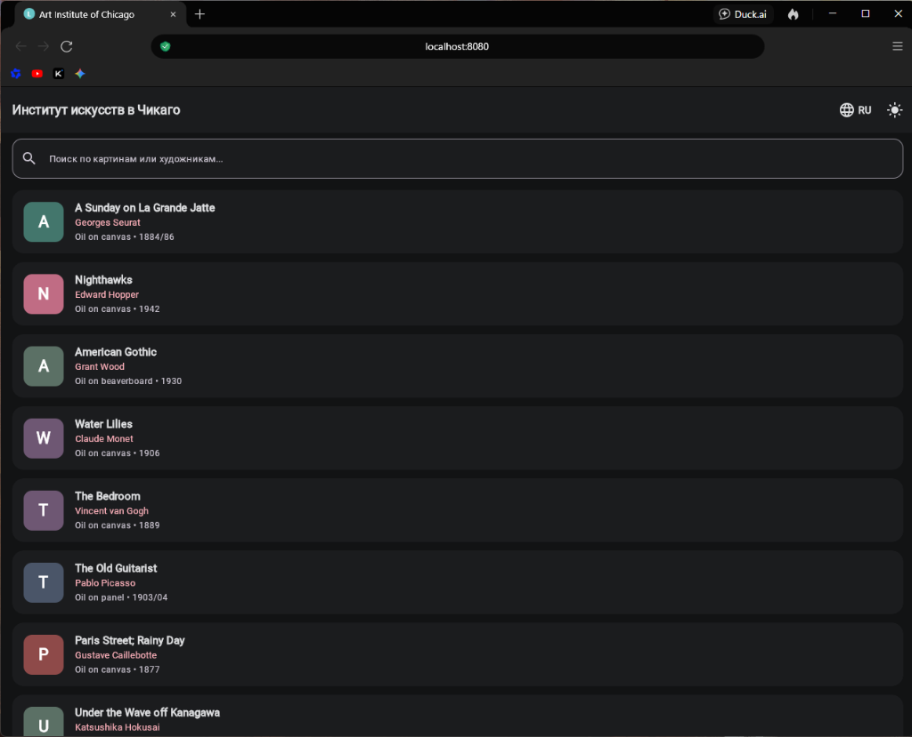 | 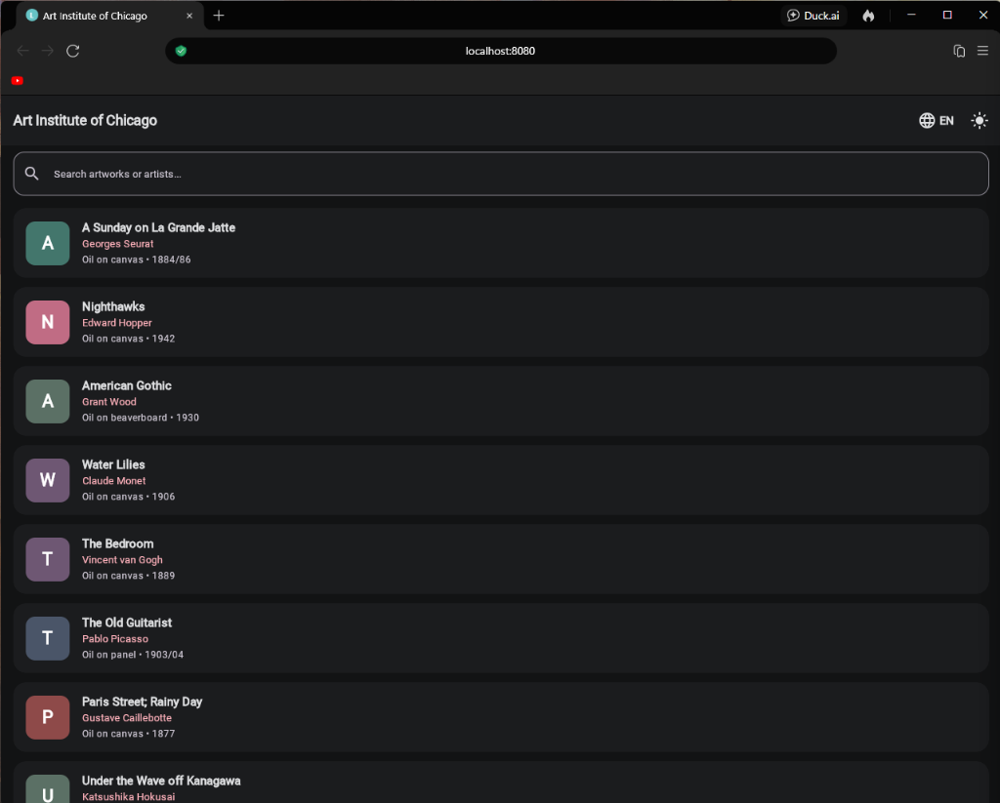 | 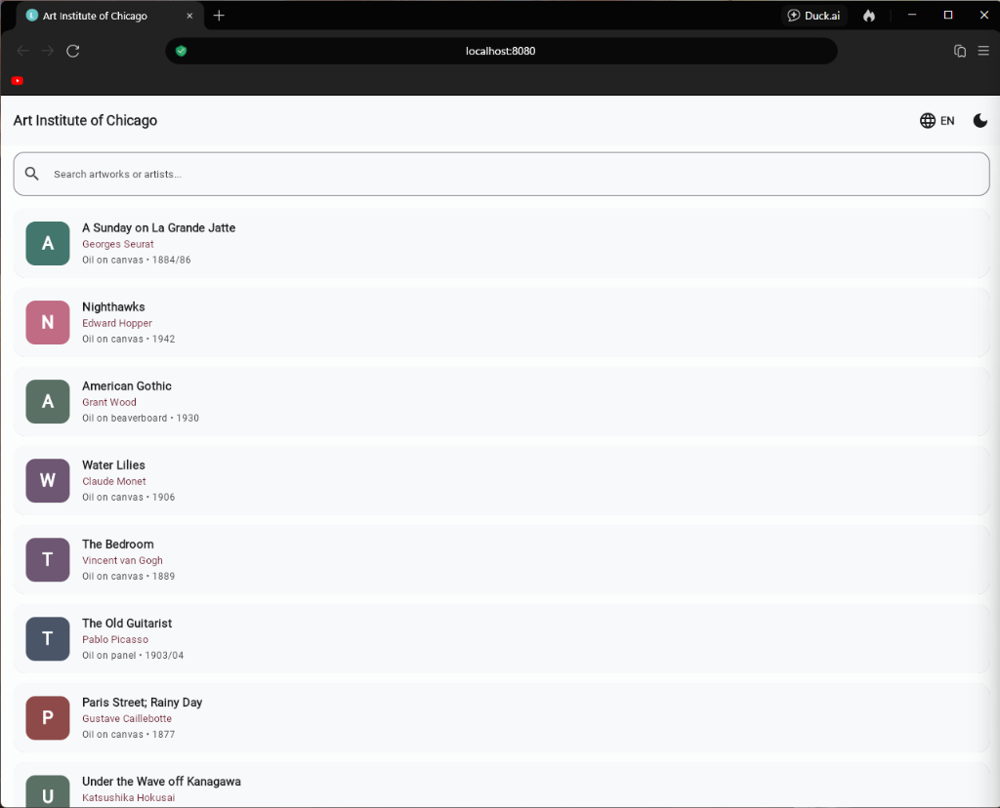 |

| Поиск и фильтрация | Экран деталей | Ничего не найдено |
|:---:|:---:|:---:|
| 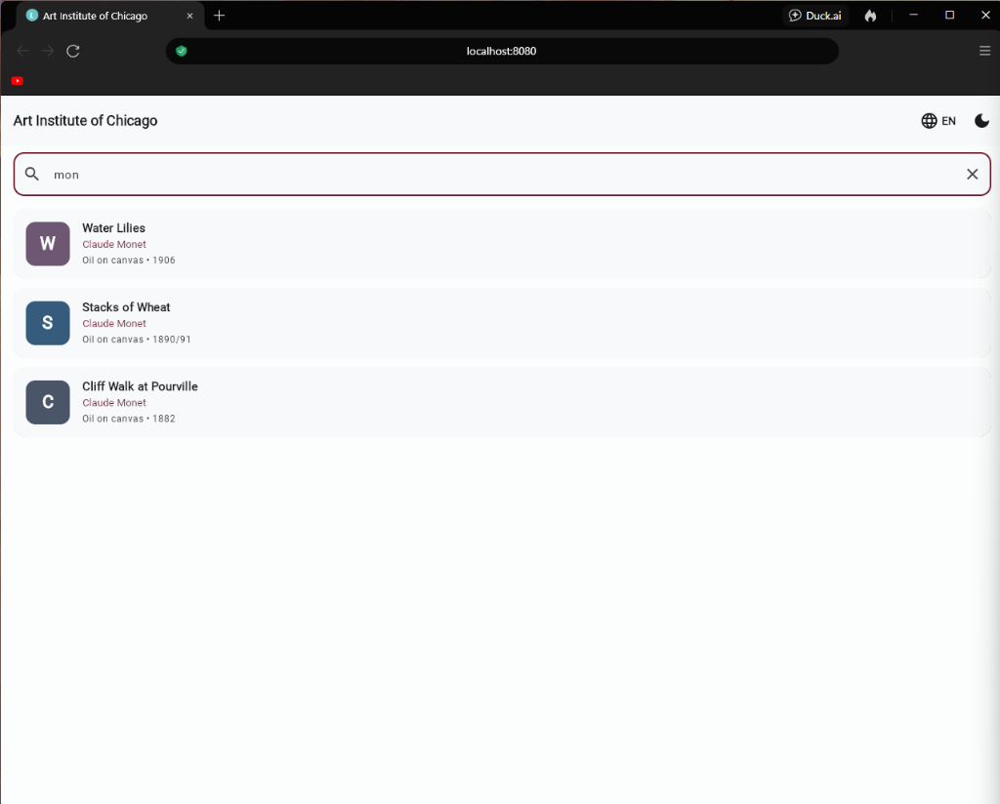 | 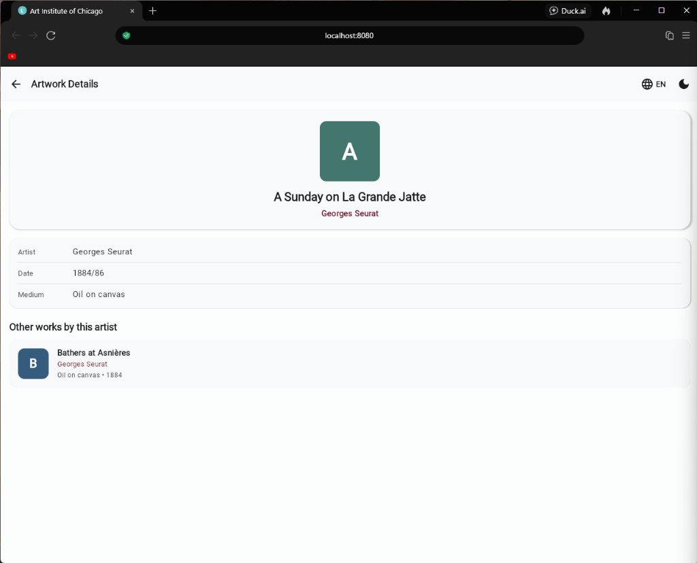 | 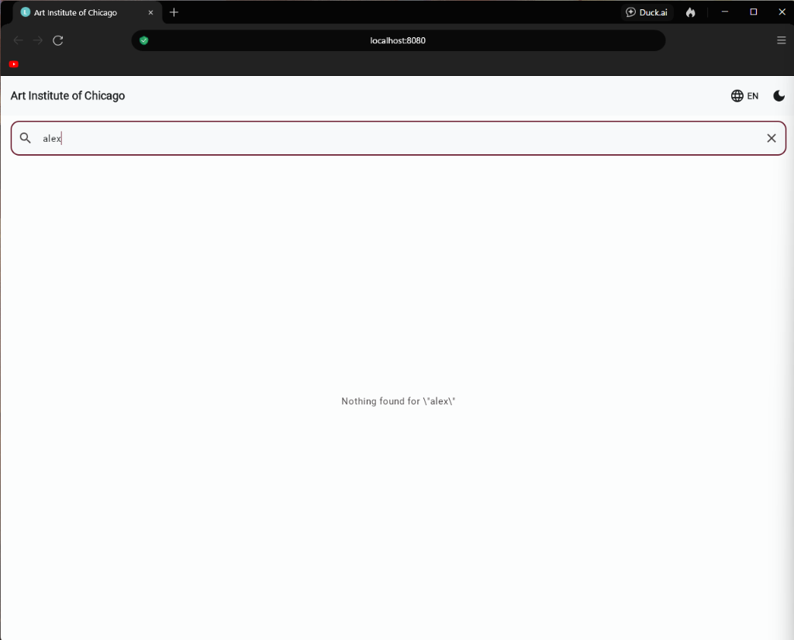 |

### Desktop
| Поиск и фильтрация | Ничего не найдено |
|:---:|:---:|
| 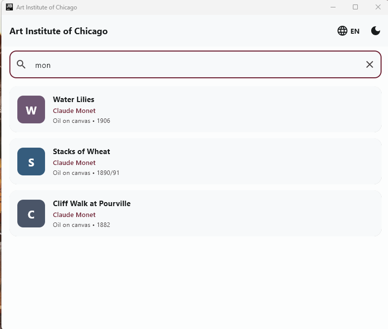 | 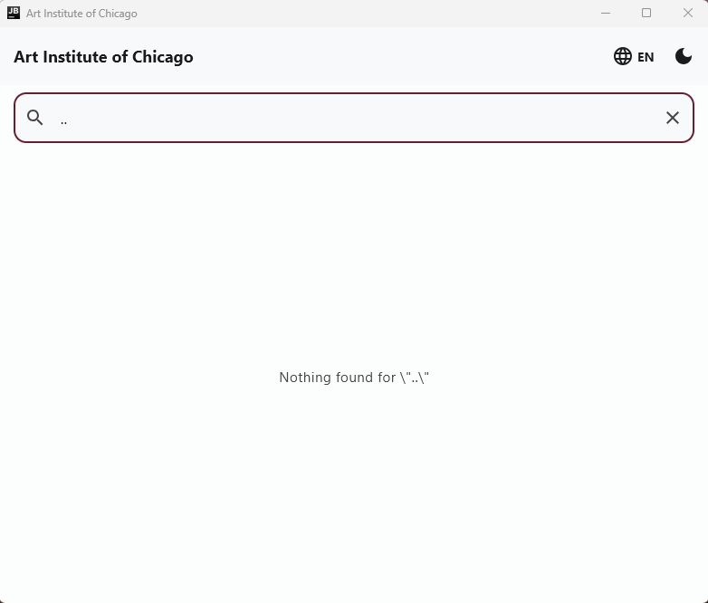 |
